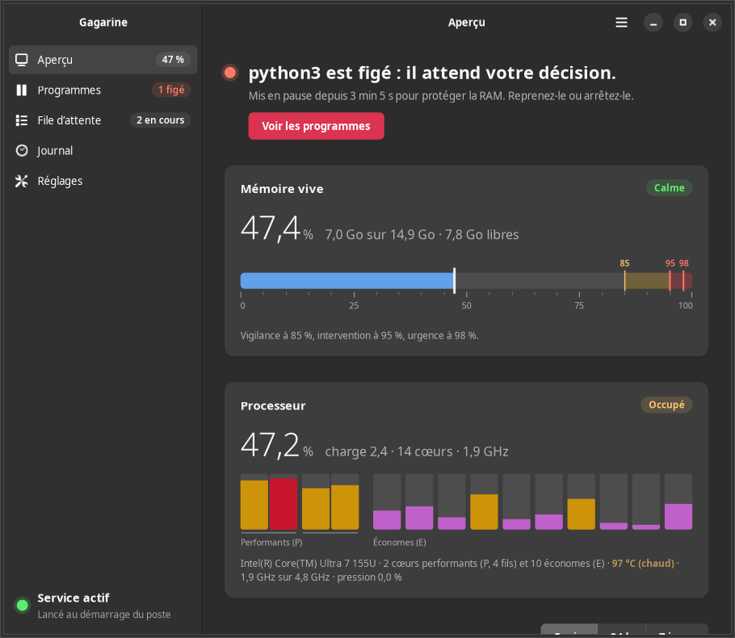
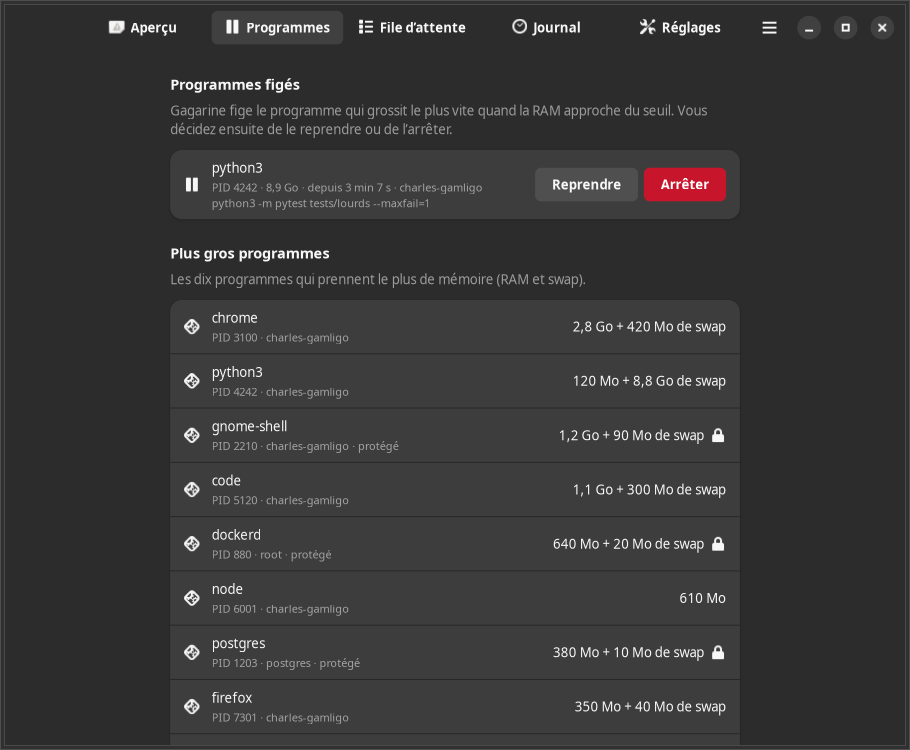
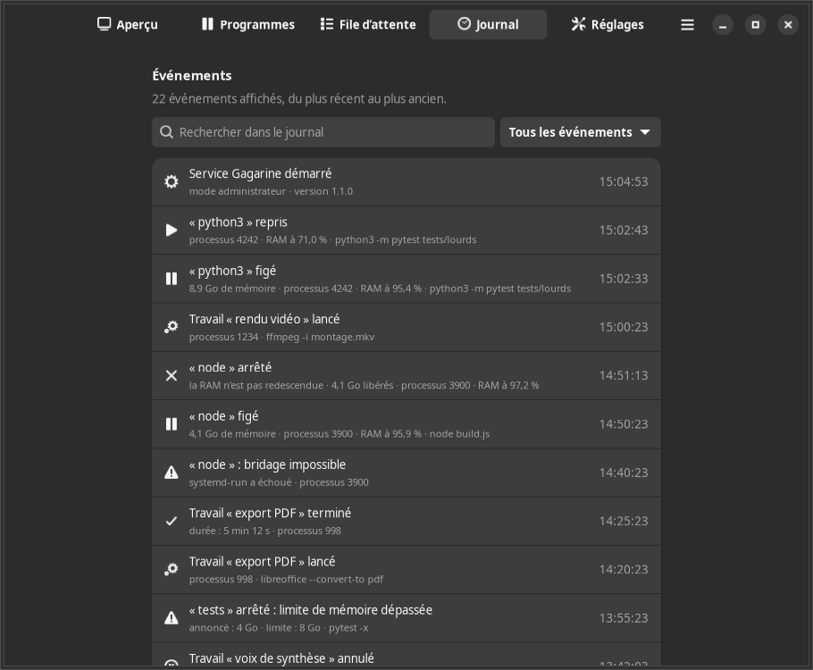
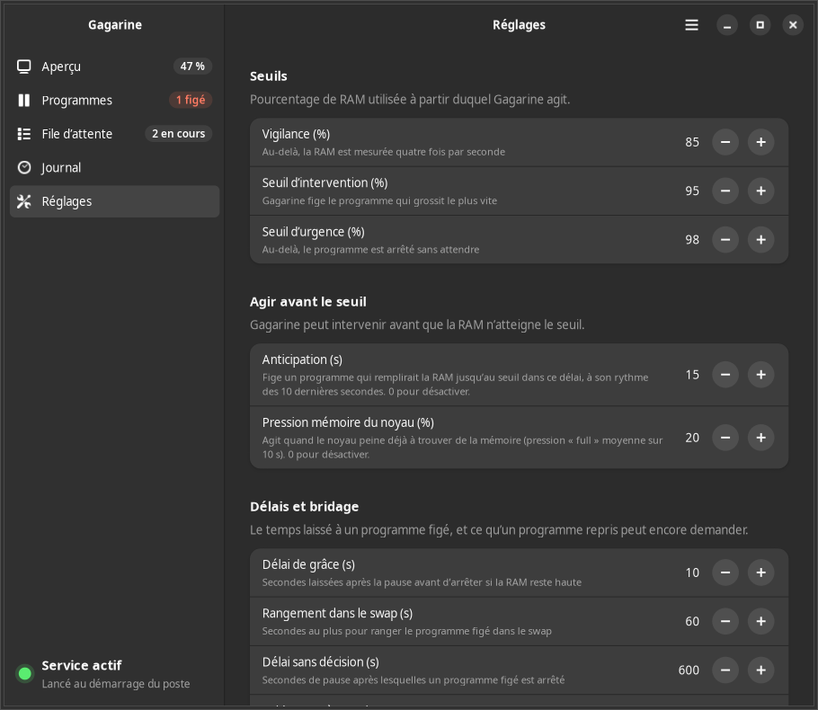

# Gagarine

Gagarine est un garde-RAM pour Linux : il empêche la mémoire vive d'un poste de se remplir au point de le figer. Il
réunit tout ce qui protège la mémoire du poste : le **garde** qui fige le programme qui s'emballe, une **file d'attente**
pour les travaux lourds, le **ménage** des programmes inactifs, un **swap compressé en RAM**, une **interface graphique**
et un **indicateur** dans la barre du haut. Il montre aussi le **processeur** : utilisation de chaque cœur, programmes les
plus actifs, température et fréquence. Il se met à jour par `apt upgrade`.

**Site et installation : [mawena.github.io/gagarine](https://mawena.github.io/gagarine/)** — dépôt APT signé, mises à
jour par `sudo apt upgrade`.

```bash
curl -fsSL https://mawena.github.io/gagarine/installer.sh | sudo sh
```



## À quoi ça sert

Quand un programme grossit sans fin (fuite de mémoire, test qui s'emballe, rendu trop lourd), il remplit la RAM, puis le
swap. Le poste passe alors son temps à échanger avec le disque : l'écran ne répond plus pendant des minutes, et il faut
souvent forcer le redémarrage. C'est arrivé le 02/11/2026, avec deux travaux lourds lancés en même temps, puis deux fois
le 10/11/2026 : un test qui avait grossi jusqu'à 9 Go a rempli les 14 Go de RAM puis les 10 Go de swap, et le poste est
resté figé.

Gagarine agit sur quatre plans :

- **à la source** : la file d'attente fait passer les travaux lourds un par un, quand la RAM et les processeurs
  suffisent, enferme chacun dans une limite mémoire du noyau, **retient la mémoire qu'il a vraiment prise** et corrige une
  annonce trop basse ; les sessions Claude Code ne peuvent plus lancer un travail lourd hors de la file ; les démons et
  modèles qui gardent la mémoire sans rien faire sont **arrêtés ou déchargés** ; chaque application du bureau peut
  recevoir un **plafond mémoire** ;
- **avant le seuil** : il mesure la RAM chaque seconde et fige plus tôt un programme qui remplirait la RAM dans les
  prochaines secondes, ou quand le noyau peine déjà faute de mémoire ;
- **au seuil** : à 95 %, il **fige** le programme qui grossit le plus vite, le **bride**, le **range dans le swap**, puis
  l'**arrête** si la RAM ne redescend pas. Le bureau et les services critiques ne sont jamais touchés, et des
  notifications (sur le bureau et, si on le veut, sur le téléphone) proposent « Arrêter » ou « Reprendre » ;
- **en réserve** : un swap compressé en RAM (zram) absorbe vite ce qui déborde, sans écrire sur le disque.

## Installation

Pour Ubuntu 24.04 (noyau 6.8, cgroup v2, systemd, GNOME), ou toute distribution Debian équivalente. Gagarine s'installe
depuis son **dépôt APT signé**, publié sur [mawena.github.io/gagarine](https://mawena.github.io/gagarine/) ; ensuite,
`sudo apt upgrade` apporte les nouvelles versions avec le reste du système.

### En une ligne

```bash
curl -fsSL https://mawena.github.io/gagarine/installer.sh | sudo sh
```

Le script ([à lire sur le site](https://mawena.github.io/gagarine/installer.sh)) ajoute la clé et le dépôt, puis
installe Gagarine : exactement les trois étapes ci-dessous.

### Pas à pas

```bash
# 1. La clé qui signe le dépôt
sudo curl -fsSLo /usr/share/keyrings/gagarine.gpg https://mawena.github.io/gagarine/apt/gagarine.gpg
# 2. Le dépôt
sudo curl -fsSLo /etc/apt/sources.list.d/gagarine.sources https://mawena.github.io/gagarine/apt/gagarine.sources
# 3. Gagarine
sudo apt update && sudo apt install gagarine
```

Empreinte de la clé du dépôt : `FE66 B5A9 00CB E8EB FB8F B079 FCA7 E8E0 C551 3B93` (« Gagarine APT (mawena) »).

### Vérifier que tout marche

```bash
sudo gagarine essai     # un programme d'essai grossit : il doit être figé, rangé dans le swap puis arrêté
```

### Mettre à jour

```bash
sudo apt update && sudo apt upgrade
```

### Sans le dépôt

Télécharger `gagarine_<version>_all.deb` et `SHA256SUMS` depuis les
[releases GitHub](https://github.com/mawena/gagarine/releases), puis :

```bash
sha256sum -c SHA256SUMS --ignore-missing
sudo apt install ./gagarine_<version>_all.deb
```

Depuis la 1.2.0, le paquet ajoute lui-même le dépôt APT et sa clé : les versions suivantes arrivent par `apt upgrade`.

À l'installation :

- le service `gagarine.service` est activé et démarré (redémarré à la mise à jour, arrêté à la suppression) ;
- le swap compressé en RAM (zram) est créé et ses réglages du noyau appliqués, sans redémarrer ;
- l'application **Gagarine** apparaît dans les applications, et l'indicateur se lance à la prochaine ouverture de session
  (ou tout de suite avec `gagarine-indicateur &`) ;
- le minuteur du ménage (`gagarine-menage.timer`) est activé pour chaque utilisateur ;
- le dépôt APT et sa clé sont ajoutés (`/etc/apt/sources.list.d/gagarine.sources`, `/usr/share/keyrings/gagarine.gpg`).

Les réglages (`/etc/gagarine.conf`) sont conservés aux mises à jour. L'interface et l'indicateur demandent des paquets
recommandés (`python3-gi`, `gir1.2-gtk-4.0`, `gir1.2-adw-1`, `gir1.2-gtk-3.0`, `gir1.2-ayatanaappindicator3-0.1`,
`pkexec`), installés d'office par `apt` ; s'il en manque un, ils le disent.

## Interface graphique

Lancer **Gagarine** depuis les applications, ou `gagarine-interface` (option `--page=apercu|programmes|file|journal|reglages`).
Cinq pages :

| Page | Contenu |
|---|---|
| **Aperçu** | jauge de la RAM avec les repères (vigilance, seuil, urgence) ; **processeur** : utilisation totale et de chaque cœur (performants et économes), température, fréquence, charge ; courbe de la RAM et du processeur sur 5 minutes, 24 heures ou 7 jours avec les incidents marqués, et les programmes les plus gros et les plus actifs de la période ; swap (zram et disque) ; état du service |
| **Programmes** | programmes figés, avec **Reprendre** et **Arrêter** ; **Fuites en cours** ; **Ménage** des programmes inactifs ; **Applications du bureau** et leur plafond mémoire ; les dix plus gros programmes et les dix plus actifs (processeur) |
| **File d'attente** | travaux en cours (plusieurs à la fois, avec les cœurs qu'ils utilisent) et en attente avec leur priorité et le motif de l'attente, **Annuler**, **Priorité…**, **Voir la sortie**, **Nouveau travail…** ; **Mémoire apprise** de chaque travail, avec sa tendance ; **Travaux passés** avec leur pic et leurs cœurs en moyenne |
| **Journal** | tous les événements (garde, file, ménage, service), filtre par type et recherche |
| **Réglages** | seuils, anticipation et pression, délais, bridage, notifications (fin de travail, téléphone), file (travaux en parallèle), fuites, ménage, sessions Claude, programmes protégés ; service ; essai ; affichage de l'indicateur |

Les actions d'administrateur (réglages, service, essai en administrateur, programme d'un autre utilisateur) passent par
la fenêtre de mot de passe du système (polkit), une seule fois pour quelques minutes. L'interface reste fluide même quand
la RAM est pleine : tout ce qu'elle demande au système se fait en arrière-plan, avec un délai maximal.

| | |
|---|---|
|  |  |
|  |  |

*Captures faites avec des données d'exemple.*

## Indicateur de la barre du haut

`gagarine-indicateur` affiche la RAM et le processeur en pourcentage dans la barre du haut (« RAM 77 % · CPU 23 % »),
avec une icône qui change selon le niveau de la RAM (normal, vigilance, alerte). Son menu montre la RAM, le swap, le
processeur (charge, température, programme le plus actif) et les travaux en file, et permet de **reprendre** ou
d'**arrêter** chaque programme figé, de faire le **ménage** des programmes inactifs, d'**ouvrir Gagarine** ou de
**masquer l'indicateur**. Il se lance à l'ouverture de
session ; `gagarine-indicateur --masquer` ou `--afficher` (ou l'interrupteur des réglages) le désactive ou le réactive.

## Processeur

Le service mesure le processeur toutes les 2 secondes : utilisation totale et de chaque cœur, programmes les plus actifs
(en cœurs utilisés, tous utilisateurs, threads du noyau compris), température, fréquence, charge et pression du noyau. Sur
un processeur hybride d'Intel, les cœurs performants (P) et économes (E) sont distingués.

```
$ gagarine processeur
Intel(R) Core(TM) Ultra 7 155U : 2 cœurs performants (4 fils) et 10 économes
Processeur : 23 % · 72 °C · 1,9 GHz (4,8 GHz au plus) · charge 2,41 · pression 0 %
```

`gagarine processeur` montre aussi une barre par cœur et les dix programmes les plus actifs ; `--json` donne la même
mesure que `gagarine etat --json` (`processeur`). Le processeur apparaît aussi dans l'interface, l'indicateur, la ligne
d'état des sessions Claude Code, l'historique et la file d'attente (cœurs utilisés par chaque travail). Gagarine
**n'agit jamais** sur un programme à cause du processeur : ses actions restent réservées à la RAM.

## File d'attente des travaux lourds

Un travail lourd (rendu vidéo, voix de synthèse, compilation, longue suite de tests, modèle local…) passe par la file :

```bash
gagarine file "rendu vidéo" 4 4 -- ffmpeg -i entree.mov sortie.mp4
#             nom           Go cœurs  commande (plusieurs : sh -c "a && b")
```

- Il attend son tour : assez de RAM disponible et de cœurs libres (`--apres PID` attend aussi la fin d'un autre
  processus). **Plusieurs travaux tournent en même temps** quand ils tiennent tous (2 au plus par défaut, réglage
  `file_paralleles` ; 1 = un seul à la fois) : la file réserve la mémoire que chaque travail en cours peut encore prendre.
- **Priorités** : `--priorite urgent|normal|fond` (normal par défaut) ; `gagarine file priorite PID|TICKET NIVEAU` change
  celle d'un travail en attente. Un travail ne double un autre que si celui-ci ne tient pas pour l'instant, et jamais un
  travail qui attend depuis plus de 10 minutes. `gagarine file --etat` dit pourquoi chacun attend.
- Il tourne ensuite dans sa propre **limite mémoire**, imposée par le noyau : max(2 × la RAM annoncée, RAM annoncée
  + 2 Go), et 512 Mo de swap au plus. S'il la dépasse, seul ce travail est arrêté (code 137), et le poste n'a rien. Il
  faut donc annoncer la RAM qu'il lui faut vraiment.
- Le code de sortie est celui de la commande. Un travail lancé par un autre travail de la file passe directement.
- `gagarine file --etat` montre la file ; `gagarine file annuler PID|TICKET` annule un travail.
- **Mémoire apprise** : la file relève le pic mémoire de chaque travail et le retient (`gagarine file appris`). Si un
  travail annonce bien moins que ce qu'il a déjà pris, elle le dit et corrige l'annonce (au plus 60 % de la RAM ; réglage
  `file_ajuster`).
- **Fuite d'un lancement à l'autre** : si le pic d'un travail monte à chaque lancement (« 2,1 → 3,4 → 5,0 Go ») ou s'il
  dépasse sa limite plusieurs fois de suite, la file le dit au lancement : fuite probable.
- **Fin de travail** : une notification dit si un travail d'au moins 30 s s'est terminé, a échoué ou a dépassé sa
  limite (réglages `notifications_fin`, `notification_fin_min`, et `ntfy` pour le téléphone).

La file est commune à tout le poste : ses tickets (`/tmp/file-attente-travaux-lourds`) sont les mêmes que ceux de l'ancien
outil `file-attente` et de ses copies dans les projets, qui continuent de partager la même file.

## Fuites de mémoire

Gagarine repère un programme qui grossit régulièrement (au moins 100 Mo par minute depuis 5 minutes, réglage
`fuite_seuil`) bien avant le seuil, et prévient : « python3 grossit de 210 Mo/min depuis 7 min : la RAM serait pleine
vers 18:42 » (sur le bureau et, si réglé, sur le téléphone ; réglage `fuite_notifier`). Il ne touche pas au programme :
le garde agit comme d'habitude si la RAM approche du seuil. `gagarine etat` liste les fuites en cours ; la page
**Programmes** les montre aussi.

## Ménage des programmes inactifs

Certains programmes gardent beaucoup de mémoire sans rien faire : démons Gradle et Kotlin après une compilation, modèles
LM Studio ou Ollama chargés pour rien, serveurs de développement oubliés. `gagarine menage` les liste (au moins 300 Mo,
processeur au repos), `gagarine menage arreter ID` les arrête ou décharge les modèles. Le minuteur utilisateur
`gagarine-menage.timer` passe toutes les 2 minutes et fait le ménage tout seul après `menage_delai` minutes
d'inactivité (5 minutes quand la RAM dépasse la vigilance) ; les serveurs de développement ne sont jamais arrêtés tout
seuls. Réglages `menage_auto` et `menage_delai`.

## Plafond mémoire des applications du bureau

`gagarine applications` liste les applications ouvertes (Chrome, VS Code, Firefox…) et leur mémoire ;
`gagarine applications plafond google-chrome 5` leur pose un plafond (`MemoryHigh` de systemd) : au-delà, l'application
est freinée et rangée dans le swap compressé, sans jamais être arrêtée. `aucun` retire le plafond. Le plafond vaut pour
toutes les fenêtres de l'application, ouvertes maintenant ou plus tard.

## Historique

Le service garde une mesure par minute pendant 8 jours. `gagarine historique --depuis 24h` (ou `5min`, `1h`, `7j`)
résume la RAM, le processeur (moyenne, pic, température), les incidents, les programmes les plus gros et les plus actifs, et
les travaux de la file ; la page **Aperçu** en trace la courbe.

## Alertes sur le téléphone

Avec l'application [ntfy](https://ntfy.sh), choisir un sujet difficile à deviner (par exemple `gagarine-k7f3q9x2`), s'y
abonner sur le téléphone, puis le régler : `sudo gagarine reglages --ecrire ntfy=gagarine-k7f3q9x2` (ou l'adresse
complète d'un sujet sur un autre serveur). Gagarine y envoie chaque programme figé ou arrêté et la fin des travaux de
la file. `gagarine ntfy essai SUJET` envoie un message d'essai.

## Sessions Claude Code

`gagarine hook-claude` sert de hook `PreToolUse` aux sessions Claude Code : il rappelle l'état du poste quand il est
chargé, signale les programmes figés ou arrêtés de la dernière demi-heure et **refuse** les travaux lourds lancés hors
de la file (tests, compilations, `ffmpeg`, `make deb`…), en donnant la commande corrigée avec la RAM apprise. Un exemple
de hook est installé dans `/usr/share/gagarine/claude/ressources-poste.sh` ; `gagarine hook-claude --tester "make deb"`
montre le verdict. Réglage `claude_bloquer`.

`gagarine ligne-etat` met l'état du poste dans la **ligne d'état** de chaque session (`statusLine` de
`~/.claude/settings.json`) : `RAM 72 % · CPU 23 % · file 3 (2 en cours) · 1 figé · fuite : python3`, en couleur selon le
niveau (la température s'ajoute quand le processeur chauffe).
`--avec "COMMANDE"` garde une ligne d'état existante et y ajoute celle de Gagarine :

```json
"statusLine": { "type": "command", "command": "gagarine ligne-etat --avec \"/usr/bin/claude-accounts statusline\"" }
```

## Utilisation en ligne de commande

| Commande | Effet |
|---|---|
| `gagarine etat [--json]` | RAM, processeur, swap, service, programmes figés, plus gros et plus actifs, file, derniers événements |
| `gagarine processeur [--json]` | processeur : modèle, cœurs, utilisation de chaque cœur, température, fréquence, charge, pression, programmes les plus actifs |
| `gagarine reprendre PID` | relance un programme figé par Gagarine (il reste bridé) |
| `gagarine arreter PID` | arrête un programme figé par Gagarine |
| `gagarine file [--priorite NIVEAU] …` | file d'attente des travaux lourds (voir plus haut) ; `gagarine file appris` : mémoire apprise ; `gagarine file priorite PID\|TICKET NIVEAU` |
| `gagarine ligne-etat [--avec "CMD"]` | ligne d'état des sessions Claude Code |
| `gagarine menage [--json]`, `menage arreter ID…` | programmes inactifs, et leur arrêt |
| `gagarine applications [--json]`, `applications plafond ID GO\|aucun` | applications du bureau et leur plafond |
| `gagarine historique [--depuis 5min\|1h\|24h\|7j] [--json]` | RAM, processeur, incidents, plus gros et plus actifs, travaux des derniers jours |
| `gagarine hook-claude [--tester "CMD"]` | hook des sessions Claude Code |
| `gagarine ntfy essai SUJET` | message d'essai sur le téléphone |
| `gagarine journal [-n N] [--json]` | les derniers événements, tous journaux fusionnés |
| `gagarine reglages [--json]` | réglages en vigueur |
| `sudo gagarine reglages --ecrire CLE=VALEUR…` | modifie `/etc/gagarine.conf` (commentaires gardés) et recharge le service |
| `sudo gagarine service ACTION` | `demarrer`, `arreter`, `redemarrer`, `activer` ou `desactiver` le service |
| `gagarine essai` | auto-test sans risque : un programme d'essai grossit, il doit être figé, rangé dans le swap puis arrêté (refusé au-delà de 80 % de RAM ; avec `sudo` pour tester le mode administrateur) |
| `gagarine surveiller [--config FICHIER]` | lance le garde au premier plan (c'est ce que fait le service) |
| `gagarine version` | affiche la version |

Les sorties `--json` sont stables d'une version à l'autre : l'interface et l'indicateur s'en servent. Journal du service :
`journalctl -u gagarine -f`. Pages de manuel : `man gagarine`, `man gagarine-interface`, `man gagarine-indicateur`.

## Configuration

Fichier `/etc/gagarine.conf`, au format INI, section `[gagarine]` : à modifier depuis la page **Réglages**, avec
`sudo gagarine reglages --ecrire seuil=94`, ou à la main puis `sudo systemctl reload gagarine` (le service relit ses
réglages sans perdre son état).

| Clé | Défaut | Rôle |
|---|---|---|
| `seuil` | 95 | % de RAM utilisée qui déclenche l'action |
| `urgence` | 98 | % au-delà duquel le programme est arrêté sans attendre |
| `vigilance` | 85 | % au-delà duquel la mesure passe à 4 fois par seconde |
| `grace` | 10 | secondes minimum laissées après la pause avant d'arrêter si la RAM reste haute |
| `vidage_max` | 60 | secondes au plus laissées au noyau pour ranger le programme dans le swap |
| `delai_fige` | 600 | secondes de pause après lesquelles un programme sans décision est arrêté |
| `reste_si_repris` | 256 | Mo qu'un programme repris peut encore demander |
| `notifications` | oui | notifications sur les sessions graphiques ouvertes |
| `proteges` | (vide) | expression régulière de noms à protéger en plus |
| `anticipation` | 15 | secondes : figer plus tôt un programme qui remplirait la RAM jusqu'au seuil dans ce délai (0 : non) |
| `pression` | 20 | % de temps où le noyau est bloqué faute de mémoire (`full avg10`) qui fait agir au-delà de la vigilance (0 : non) |
| `notifications_fin` | oui | notification à la fin d'un travail de la file |
| `notification_fin_min` | 30 | secondes : pas de notification de fin pour un travail plus court |
| `ntfy` | (vide) | sujet ntfy (ou adresse complète) pour les alertes sur le téléphone |
| `file_ajuster` | oui | la file corrige d'elle-même une annonce bien plus basse que la mémoire déjà mesurée |
| `menage_auto` | oui | ménage automatique des démons et modèles inactifs |
| `menage_delai` | 30 | minutes d'inactivité avant le ménage automatique |
| `claude_bloquer` | oui | le hook des sessions Claude refuse les travaux lourds hors de la file |
| `file_paralleles` | 2 | travaux de la file qui peuvent tourner en même temps quand ils tiennent (1 : un seul) |
| `fuite_seuil` | 100 | Mo/min : un programme qui grossit ainsi depuis 5 min est signalé comme fuite (0 : non) |
| `fuite_notifier` | oui | notification (et ntfy) quand une fuite est repérée |

Variables d'environnement (prioritaires sur le fichier) : `GAGARINE_CONFIG`, `GAGARINE_ETAT`, `GAGARINE_SEUIL`, etc. ;
`FILE_ATTENTE_DOSSIER` pour le dossier des tickets de la file.

### Swap compressé en RAM

Le paquet fournit un zram de la taille de la RAM, compressé en zstd (3 à 4 fois en moyenne, donc un quart à un tiers de
la RAM quand il est plein), utilisé **avant** le swap disque, qui reste en dernier recours et pour l'hibernation :

- `/usr/lib/systemd/zram-generator.conf.d/50-gagarine.conf` (taille, compression, priorité 100) ;
- `/usr/lib/sysctl.d/90-gagarine.conf` (`vm.swappiness = 180`, `vm.watermark_scale_factor = 125`,
  `vm.watermark_boost_factor = 0`, `vm.page-cluster = 0`, les réglages de Pop!_OS pour un swap en RAM).

Pour en changer, mettre un fichier dans `/etc/systemd/zram-generator.conf.d/` ou `/etc/sysctl.d/` (voir
`zram-generator.conf(5)` et `sysctl.d(5)`). État : `swapon --show`, `zramctl`, ou la page **Aperçu**.

## Fonctionnement détaillé du garde

1. **Mesure** : la RAM utilisée est `100 % − MemAvailable / MemTotal` (le cache récupérable compte comme libre), lue
   chaque seconde, quatre fois par seconde au-delà de 85 %.
2. **Choix du coupable** : le programme dont la mémoire (RAM + swap) a le plus augmenté sur 10 s, puis sur 60 s, à défaut
   le plus gros. Le bureau (gnome-shell, Xorg, le son, D-Bus, systemd…) et les services critiques sont protégés.
   **Au-delà de 85 %**, sans attendre le seuil : si ce programme, à son rythme des 10 dernières secondes, remplirait la
   RAM jusqu'au seuil en moins de 15 s (**anticipation**), ou si le noyau passe plus de 20 % de son temps bloqué faute de
   mémoire (**pression**), il est figé tout de suite.
3. **Figer** : SIGSTOP. Le programme ne peut plus rien demander.
4. **Brider** : il est placé dans un scope systemd limité en mémoire. S'il est repris, il ne peut grossir que de 256 Mo.
5. **Ranger dans le swap** : en administrateur, `process_madvise` demande au noyau de pousser la mémoire du seul programme
   figé dans le swap, sans toucher aux autres (sur le poste, 850 Mo rangés en une seconde dans le zram).
6. **Arrêter** (SIGKILL) : si la RAM n'est pas redescendue sous le seuil une fois le rangement fini, si elle atteint 98 %, ou
   si le programme reste figé 10 minutes sans décision.
7. **Notifications** : sur chaque session graphique ouverte, avec les boutons « Arrêter » et « Reprendre ».

Le service est prévu pour ne jamais lâcher : jamais choisi par le noyau comme victime (`OOMScoreAdjust=-1000`),
prioritaire (processeur et disque), verrouillé en RAM, relancé en une seconde s'il s'arrête, et sans durcissement qui
bloquerait ses accès (`/proc`, cgroups, D-Bus, `process_madvise`, `runuser`, `notify-send`).

## Pourquoi pas systemd-oomd ou earlyoom ?

- **systemd-oomd** et **earlyoom** arrêtent un programme : le travail est perdu, parfois sur un mauvais choix. Gagarine
  **fige d'abord** : rien n'est perdu tant que la RAM redescend et que l'utilisateur reprend.
- Ils réagissent à la pression de la mémoire ou au manque de RAM et de swap ; Gagarine agit **avant** que le swap ne se
  remplisse, car c'est lui qui fige le poste.
- Gagarine choisit le programme qui **grossit le plus vite**, pas le plus gros, et le **bride** s'il est repris.
- Ils ne préviennent pas la saturation : la **file d'attente** de Gagarine évite de lancer deux travaux lourds à la fois.

Ils se complètent : on peut garder `systemd-oomd`.

## Structure du dépôt

```
gagarine/                 le programme (paquet Python)
  cli.py                  commandes, sorties texte et JSON
  garde.py                le garde : choix du coupable, anticipation, pression, figer, brider, ranger, arrêter
  file.py                 file d'attente des travaux lourds, mémoire apprise, notification de fin
  menage.py               ménage des démons et modèles inactifs
  applications.py         plafond mémoire des applications du bureau
  historique.py           historique de 7 jours
  processeur.py           mesure du processeur (cœurs, programmes actifs, température, fréquence)
  claude.py               hook des sessions Claude Code
  ligne.py                ligne d'état des sessions Claude Code
  ntfy.py                 alertes sur le téléphone
  systeme.py              accès au système (/proc, cgroups, appels système, notifications)
  reglages.py journal.py essai.py version.py
  interface/              interface graphique (GTK 4 + libadwaita)
  indicateur/             indicateur de la barre du haut (GTK 3 + AyatanaAppIndicator)
bin/                      lanceurs gagarine, gagarine-interface, gagarine-indicateur
etc/gagarine.conf         réglages par défaut (conffile)
systemd/gagarine.service  unité systemd
data/                     bureau (.desktop, icônes, metainfo, polkit, autostart), zram, sysctl, minuteur du ménage,
                          hook Claude, source et clé du dépôt APT
site/                     page d'accueil (https://mawena.github.io/gagarine/) et script d'installation
man/                      pages de manuel
debian/                   paquet Debian
scripts/build-deb.sh      construction du .deb dans dist/
scripts/publier-apt.sh    publication du dépôt APT signé et du site (branche gh-pages)
docs/                     conception des versions 1.1.0 à 1.4.0, captures
tests/                    tests unitaires
Makefile                  cibles test, deb, apt, clean
```

Le cœur n'utilise que la bibliothèque standard de Python ; seuls `interface/` et `indicateur/` utilisent PyGObject, et ils
ne parlent au cœur qu'à travers la ligne de commande (`--json`).

## Développement

```bash
make test    # python3 -m unittest discover -s tests -t .
make deb     # tests, dist/gagarine_<version>_all.deb, SHA256SUMS, validations, lintian
make apt     # publie dist/*.deb dans le dépôt APT signé et met le site à jour (branche gh-pages)
make clean
```

Sur le poste de développement, les tests passent eux aussi par la file : `gagarine file "tests" 1 2 -- make test`.
La clé qui signe le dépôt APT (empreinte dans `data/apt/LISEZMOI`) est dans le trousseau du mainteneur ; elle expire en
novembre 2029.

Depuis le dépôt, `bin/gagarine`, `bin/gagarine-interface` et `bin/gagarine-indicateur` utilisent le code du dépôt.
`GAGARINE_COMMANDE` désigne la commande `gagarine` qu'utilisent l'interface et l'indicateur (les tests leur donnent un
faux `gagarine`, dans `tests/donnees_interface/` et `tests/donnees_indicateur/`).

La version est dans `gagarine/version.py` (`VERSION`) et dans `debian/changelog` ; `make deb` refuse de construire si
elles diffèrent. Dépendances de construction : `debhelper`, `dpkg-dev`, `lintian`, `desktop-file-utils`, `appstream`.

## Licence

[MIT](LICENSE) © 2026 mawena
